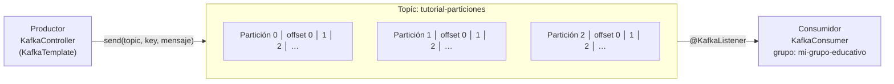

# Guía 3.2.1 — Kafka: topic, productor y consumidor; offsets y particiones

**Desarrollo Cloud Native I (DSY1107)** · Duoc UC

Esta guía explica la actividad 3.2.1: levantar Kafka en Docker, crear un topic con 3 particiones, y enviar y leer
mensajes con Spring Boot para ver **en qué partición y offset** cae cada uno. El código de esta carpeta es la
solución funcionando.

## Índice

1. [Objetivos](#1-objetivos)
2. [Conceptos clave](#2-conceptos-clave)
3. [Levantar el entorno](#3-levantar-el-entorno-docker)
4. [Crear el topic](#4-crear-el-topic)
5. [La aplicación Spring Boot](#5-la-aplicación-spring-boot)
6. [Pruebas: offsets y particiones](#6-pruebas-offsets-y-particiones)
7. [Errores comunes](#7-errores-comunes)
8. [Preguntas de repaso](#8-preguntas-de-repaso)

---

## 1. Objetivos

Al terminar deberías poder:

1. Explicar qué es un topic, una partición y un offset.
2. Levantar Kafka, ZooKeeper y Kafka UI con Docker Compose.
3. Crear un topic desde Kafka UI o por línea de comandos.
4. Programar un productor (API REST) y un consumidor (`@KafkaListener`) en Spring Boot.
5. Demostrar la diferencia clave:
   - **Sin key:** Kafka elige la partición automáticamente.
   - **Con key:** todos los mensajes con la misma key van a la **misma partición** y conservan su orden.

**Stack:** Docker Compose · Confluent Kafka 7.5.0 · Kafka UI · Java 17+ · Spring Boot 3.2.0 · Spring Kafka.

## 2. Conceptos clave



| Concepto | Qué es | En esta práctica |
|---|---|---|
| Broker | Servidor de Kafka que guarda y entrega los mensajes | Contenedor `kafka` (puerto 9092) |
| ZooKeeper | Coordina el clúster y guarda sus metadatos | Contenedor `zookeeper` (puerto 2181) |
| Topic | Canal con nombre donde se publican los mensajes | `tutorial-particiones` |
| Partición | Subdivisión del topic; un registro ordenado donde solo se agrega al final | 0, 1 y 2 |
| Offset | Posición de un mensaje dentro de **su** partición; parte en 0 | 0, 1, 2, 3… |
| Key | Clave opcional; decide a qué partición va el mensaje | `null` u `orden-555` |
| Productor | Aplicación que envía mensajes | `KafkaController` |
| Consumidor | Aplicación que lee mensajes | `KafkaConsumer` |
| Consumer group | Grupo que reparte el trabajo y recuerda el último offset leído | `mi-grupo-educativo` |
| Replication factor | Cuántas copias de cada partición existen | 1 (un broker); en producción, 2 o 3 |

**Ideas que debes recordar:**

- El orden está garantizado **solo dentro de una partición**, no en todo el topic.
- Cada partición numera sus offsets por separado: puede haber un "offset 0" en las tres.
- Leer un mensaje **no lo borra**; cada grupo de consumidores avanza su propio offset.
- Con key: partición = `hash(key) % número de particiones`. La misma key siempre da la misma partición.

## 3. Levantar el entorno (Docker)

El archivo [`docker-compose.yml`](docker-compose.yml) levanta 3 servicios:

| Servicio | Imagen | Puerto | Para qué |
|---|---|---|---|
| `zookeeper` | `confluentinc/cp-zookeeper:7.5.0` | 2181 | Coordina el clúster |
| `kafka` | `confluentinc/cp-kafka:7.5.0` | 9092 | El broker |
| `kafka-ui` | `provectuslabs/kafka-ui` | 8080 | Ver topics, particiones y offsets |

```bash
cd kafka-tutorial
docker compose up -d
docker compose ps
```

Abre Kafka UI en <http://localhost:8080>.

**Por qué hay dos listeners:** Kafka UI vive dentro de Docker y se conecta a `kafka:29092`. La app Spring Boot corre en
tu PC y se conecta a `localhost:9092`.

> La guía original trae `version: '3.8'` al inicio del compose. Docker Compose v2 ya no la usa y solo muestra un
> aviso, por eso aquí se omitió.

## 4. Crear el topic

`KAFKA_AUTO_CREATE_TOPICS_ENABLE` está en `false`: **el topic debe existir antes de enviar mensajes.**

**Opción A, Kafka UI:** Topics → **+ Add a Topic** → completa y presiona **Create topic**.

| Campo | Valor | Por qué |
|---|---|---|
| Topic Name | `tutorial-particiones` | Canal donde enviaremos los mensajes |
| Partitions | 3 | Para ver cómo se reparten |
| Replication Factor | 1 | Hay 1 solo broker |

**Opción B, línea de comandos:**

```bash
docker compose exec kafka kafka-topics --create \
  --bootstrap-server localhost:9092 \
  --topic tutorial-particiones \
  --partitions 3 \
  --replication-factor 1

docker compose exec kafka kafka-topics --describe \
  --bootstrap-server localhost:9092 \
  --topic tutorial-particiones
```

Salida esperada (verificada):

```text
Topic: tutorial-particiones  PartitionCount: 3  ReplicationFactor: 1
    Partition: 0  Leader: 1  Replicas: 1  Isr: 1
    Partition: 1  Leader: 1  Replicas: 1  Isr: 1
    Partition: 2  Leader: 1  Replicas: 1  Isr: 1
```

> La guía original usa `docker exec -it kafka-tutorial-proyecto-kafka-1 bash`. Ese nombre depende de la carpeta del
> proyecto; `docker compose exec kafka ...` funciona siempre.

## 5. La aplicación Spring Boot

```text
kafka-tutorial/
├── docker-compose.yml
├── pom.xml
└── src/
    ├── main/java/com/kafka/
    │   ├── KafkaTutorialApplication.java      clase principal
    │   ├── controller/KafkaController.java    PRODUCTOR (endpoint REST)
    │   └── consumer/KafkaConsumer.java        CONSUMIDOR (@KafkaListener)
    ├── main/resources/application.yml         configuración
    └── test/java/com/kafka/ParticionesTest.java  prueba con Kafka embebido
```

### Configuración — [`application.yml`](src/main/resources/application.yml)

| Propiedad | Valor | Significado |
|---|---|---|
| `spring.kafka.bootstrap-servers` | `localhost:9092` | Dónde está el broker |
| `consumer.group-id` | `mi-grupo-educativo` | Grupo que recuerda los offsets leídos |
| `consumer.auto-offset-reset` | `earliest` | Si el grupo es **nuevo**, lee desde el inicio |
| `consumer.enable-auto-commit` | `true` | Guarda el offset leído automáticamente |
| `*-serializer` / `*-deserializer` | `String…` | Key y mensaje viajan como texto |
| `server.port` | `8888` | El 8080 ya lo usa Kafka UI |

### Productor — [`KafkaController.java`](src/main/java/com/kafka/controller/KafkaController.java)

```java
@GetMapping("/send")
public String sendMessage(@RequestParam String message,
                          @RequestParam(required = false) String key) {
    if (key != null && !key.isEmpty()) {
        kafkaTemplate.send(TOPIC, key, message);   // con key: hash(key) -> misma partición
        ...
    }
    kafkaTemplate.send(TOPIC, message);            // sin key: Kafka elige la partición
    ...
}
```

> La guía original muestra dos versiones del controlador (GET y POST). Aquí se usa **solo la GET**, porque las
> pruebas se hacen desde el navegador. Si copias ambas clases, Spring falla con dos beans `kafkaController`.

### Consumidor — [`KafkaConsumer.java`](src/main/java/com/kafka/consumer/KafkaConsumer.java)

```java
@KafkaListener(topics = "tutorial-particiones", groupId = "mi-grupo-educativo")
public void listen(@Payload String message,
                   @Header(KafkaHeaders.RECEIVED_PARTITION) int partition,
                   @Header(KafkaHeaders.OFFSET) long offset,
                   @Header(name = KafkaHeaders.RECEIVED_KEY, required = false) String key) { ... }
```

> Se agregó `required = false` al header de la key. Los mensajes sin key no traen ese header y, sin esa opción, el
> listener puede fallar con `Missing header 'kafka_receivedMessageKey'`.

### Compilar y ejecutar

```bash
mvn clean install
mvn spring-boot:run
```

En la consola: `Tomcat started on port(s): 8888`. En otra terminal:

```bash
curl http://localhost:8888/api/kafka/health
# Aplicación de Kafka Tutorial está corriendo en puerto 8888
```

## 6. Pruebas: offsets y particiones

### Prueba 1 — sin key

```text
http://localhost:8888/api/kafka/send?message=Mensaje1
http://localhost:8888/api/kafka/send?message=Mensaje2
http://localhost:8888/api/kafka/send?message=Mensaje3
```

| Mensaje | Lo que dice la guía original | Lo que salió al ejecutarlo |
|---|---|---|
| Mensaje1 | partición 0, offset 0 | partición 1, offset 0 |
| Mensaje2 | partición 1, offset 0 | partición 1, offset 1 |
| Mensaje3 | partición 2, offset 0 | partición 1, offset 2 |

**¿Por qué cayeron todos en la misma partición?** Desde Kafka 2.4, el productor sin key usa un *sticky
partitioner*: llena un lote en una partición antes de pasar a otra, por eficiencia. No es un round robin puro.

**Para ver el reparto 0, 1, 2** que muestra la guía, activa el particionador round robin. Descomenta en
`application.yml`:

```yaml
    producer:
      properties:
        partitioner.class: org.apache.kafka.clients.producer.RoundRobinPartitioner
```

Resultado verificado con esa opción: `RR-A → partición 1`, `RR-B → partición 2`, `RR-C → partición 0`.

### Prueba 2 — con key (ciclo de vida de una orden)

```text
http://localhost:8888/api/kafka/send?message=Paso1-Creada&key=orden-555
http://localhost:8888/api/kafka/send?message=Paso2-Pagada&key=orden-555
http://localhost:8888/api/kafka/send?message=Paso3-Enviada&key=orden-555
```

Consola (ejecución real):

```text
============================================================
 MENSAJE RECIBIDO
   Partición: 2
   Offset:    0
   Key:       orden-555
   Mensaje:   Paso1-Creada
============================================================
   Partición: 2 | Offset: 1 | Paso2-Pagada
   Partición: 2 | Offset: 2 | Paso3-Enviada
```

**Qué observar:**

- Los 3 pasos fueron a la **misma** partición. En la guía original es la 1; aquí fue la 2. Depende del hash de la key
  y de cuántas particiones haya, pero para `orden-555` siempre será la misma.
- Los offsets son consecutivos: el orden Creada → Pagada → Enviada se respeta.
- Sin key, un consumidor podría procesar "Enviada" antes que "Pagada".

### Ver los mensajes en Kafka UI

1. <http://localhost:8080> → Topics → `tutorial-particiones` → pestaña **Messages**.
2. Revisa las columnas Partition, Offset, Key y Value. Deben coincidir con la consola.

### Persistencia: ¿se releen al reiniciar?

**No.** Verificado: tras reiniciar la app se releyeron **0** mensajes. El grupo `mi-grupo-educativo` guardó
(*commit*) el offset de cada partición y continúa desde el siguiente.

- `auto-offset-reset: earliest` **solo** aplica cuando el grupo no tiene offsets guardados.
- **Experimento:** cambia `groupId` a `mi-grupo-nuevo` y reinicia. Al ser un grupo sin historial, vuelve a leer todo
  desde el offset 0.

### Prueba automática (sin Docker)

```bash
mvn test
```

[`ParticionesTest`](src/test/java/com/kafka/ParticionesTest.java) levanta un Kafka embebido con 3 particiones y
comprueba que los 3 mensajes de `orden-555` quedan en la misma partición con offsets consecutivos.

## 7. Errores comunes

| Síntoma | Causa | Solución |
|---|---|---|
| Sin key, todos caen en la misma partición | *Sticky partitioner* (normal desde Kafka 2.4) | Activa `RoundRobinPartitioner` (sección 6) |
| El envío se queda esperando o falla con `UNKNOWN_TOPIC` | El topic no existe y la auto-creación está apagada | Crea `tutorial-particiones` (sección 4) |
| `Connection to node -1 (localhost:9092) could not be established` | Kafka no está arriba | `docker compose ps` y revisa `bootstrap-servers` |
| `Port 8080 was already in use` | Kafka UI usa el 8080 | `server.port: 8888` |
| `Missing header 'kafka_receivedMessageKey'` | Mensaje sin key y header obligatorio | `@Header(name = ..., required = false)` |
| `No such container: kafka-tutorial-proyecto-kafka-1` | El nombre depende de la carpeta | `docker compose exec kafka ...` |
| Dos beans `kafkaController` | Se copiaron las versiones GET y POST | Deja una sola clase |
| Al reiniciar no aparece nada | El grupo ya hizo commit de esos offsets | Usa un `groupId` nuevo |
| En la consola de Windows se ve `Partici?n` | Codificación de la terminal | `chcp 65001` antes de ejecutar, o ignóralo |

**Nota de vocabulario:** la guía original llama *Round Robin* al envío sin key y *Sticky Partitioning* al envío con
key. En la documentación oficial, el envío **con key** es particionado por **hash de la key**, y *sticky* se
refiere al envío **sin** key.

## 8. Preguntas de repaso

<details><summary>1. ¿Qué diferencia hay entre un topic y una partición?</summary>

El topic es el canal lógico (`tutorial-particiones`). Las particiones son las divisiones donde se guardan sus
mensajes (0, 1 y 2).
</details>

<details><summary>2. ¿El offset es único en todo el topic?</summary>

No. Es la posición dentro de una partición; cada partición tiene su propio offset 0, 1, 2…
</details>

<details><summary>3. ¿Qué garantiza enviar mensajes con la misma key?</summary>

Que van a la misma partición y, por lo tanto, se leen en el mismo orden en que se enviaron.
</details>

<details><summary>4. ¿Kafka garantiza orden en todo el topic?</summary>

No, solo dentro de cada partición.
</details>

<details><summary>5. Si reinicio la app, ¿vuelve a leer los mensajes?</summary>

No. El grupo ya guardó sus offsets y continúa desde el siguiente mensaje.
</details>

<details><summary>6. ¿Cuándo aplica <code>auto-offset-reset: earliest</code>?</summary>

Solo cuando el grupo no tiene offsets guardados: entonces lee desde el inicio de cada partición.
</details>

<details><summary>7. ¿Por qué el replication factor es 1?</summary>

Porque hay un solo broker, y no se pueden tener más copias que brokers. En producción se usa 2 o 3.
</details>

<details><summary>8. ¿Para qué sirven <code>kafka:29092</code> y <code>localhost:9092</code>?</summary>

`kafka:29092` es para clientes dentro de Docker (Kafka UI). `localhost:9092` es para clientes en tu PC (Spring Boot).
</details>

<details><summary>9. Con 3 particiones y 4 consumidores en el mismo grupo, ¿qué pasa?</summary>

Uno queda inactivo: dentro de un grupo, cada partición la lee un solo consumidor.
</details>

<details><summary>10. Sin key, ¿por qué los mensajes pueden caer todos en la misma partición?</summary>

Por el *sticky partitioner*, que agrupa mensajes seguidos en una partición para enviarlos en lote.
</details>

---

**Fuente:** *Guía — Crear topic, productor y consumidor; offsets y particiones*, Duoc UC, Escuela de Informática y
Telecomunicaciones, 2025. Las notas sobre *sticky partitioner*, `required = false` y el vocabulario de particionado
se verificaron al ejecutar este proyecto.
